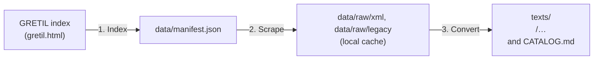

# GRETIL Sanskrit texts: scraper and Markdown converter

A deterministic toolkit to crawl, scrape and convert the Sanskrit texts of [GRETIL (Göttingen Register of Electronic Texts in
Indian Languages)](https://gretil.sub.uni-goettingen.de/gretil.html) into structured Markdown, built with Python and run with
[`uv`](https://docs.astral.sh/uv/). The converted texts are the source for the GRETIL texts in
[MEOBTIS](https://meobtis.github.io), an index of Buddhist texts in Sanskrit, alongside
[meobtis/dsbc](https://github.com/meobtis/dsbc) and [meobtis/sarit](https://github.com/meobtis/sarit).

## 1. What is in this repository

This repository is **complete for Sanskrit**: it has every Sanskrit text that GRETIL serves, not only the Buddhist ones.
GRETIL lists **781 Sanskrit texts**; **766** are converted here (757 from TEI XML, 9 from the older HTML
format). The other **15** are listed on GRETIL's index page, but its server does not have the files (404), so they
cannot be converted; they are recorded in [`data/unavailable.json`](data/unavailable.json) and listed at the end of this
README.

Each text says in its front matter whether it is Buddhist (`buddhist: true` or `false`), so that a website or tool can
choose what to show. **MEOBTIS lists only the Buddhist texts.** The flag follows GRETIL's own classification: `true` for
the two sections *Religious Literature / Buddhist* (221 texts) and *Philosophy / Buddhist* (126), and `false` for
everything else. GRETIL files a few Buddhist works under other sections, for example Aśvaghoṣa's *Buddhacarita* and
*Saundarananda* under *Poetry / Kāvya*; they are `buddhist: false` here, and a website that wants them can add them.

What is not here: GRETIL's other languages (Pali, Prakrit, Hindi, Marathi, Tamil and other Dravidian languages, Old Javanese,
Tibetan), its secondary resources (dictionaries and the like), and two excerpts from its Old Javanese section that it lists
among the Sanskrit texts.

## 2. Layout

The folders under `texts/` follow GRETIL's own sections (language > section > subsection), so the texts are not in one flat
list. A folder with more than 60 texts (only the two Buddhist ones) is split by the first letter of the title.

```
texts/
├── CATALOG.md              every text by section, with links to the Markdown and to GRETIL
├── epics/  (7)
│   ├── mahabharata/  (5)
│   ├── ramayana/  (2)
├── later-works/  (1)
│   ├── 20th-century/  (1)
├── poetry/  (114)
│   ├── alamkara/  (27)
│   ├── chandas/  (4)
│   ├── drama/  (10)
│   ├── historical/  (2)
│   ├── kavya/  (55)
│   ├── narrative-literature/  (7)
│   ├── natya/  (2)
│   ├── subhasita/  (7)
├── purana/  (18)
├── religious-literature/  (281)
│   ├── buddhist/  (221)
│   ├── jaina/  (1)
│   ├── saiva/  (31)
│   ├── vaisnava/  (28)
├── sastra/  (298)
│   ├── arthasastra/  (1)
│   ├── astrology-astronomy-mathematics/  (12)
│   ├── ayurveda-alchemy-etc/  (20)
│   ├── dharmasastra/  (17)
│   ├── grammar/  (8)
│   ├── kamasastra/  (5)
│   ├── lexicography/  (1)
│   ├── philosophy/  (234)
├── veda/  (47)
│   ├── aranyaka/  (1)
│   ├── brahmana/  (4)
│   ├── samhita/  (7)
│   ├── upanisad/  (17)
│   ├── vedanga/  (18)
```

Each file is `texts/<section folders>/<title>.md` and begins with YAML front matter:

```yaml
title: Niṣpaṇṇayogāvali
category: Buddhist Religious Literature   # GRETIL's section (the full path for other sections)
section: Religious Literature / Buddhist
buddhist: true
language: sa
gretil_id: sa_abhayAkaragupta-niSpaNNayogAvali
source_url: https://gretil.sub.uni-goettingen.de/gretil/corpustei/sa_abhayAkaragupta-niSpaNNayogAvali.xml
author: Abhayākaragupta                    # when the header names one
source_edition: …                          # the printed edition, when the header names one
contributors: […]                          # data entry and normalisation, from the TEI header
licence: Distributed under a Creative Commons Attribution-NonCommercial-ShareAlike 4.0 International License.
keywords: […]
```

When two texts in one folder have the same title (for example several recensions), the GRETIL id is added to each file name.

## 3. Licences

GRETIL's TEI texts state their licence in the header, recorded in the `licence` field: for 756 of the 766 texts it is
[CC BY-NC-SA 4.0](https://creativecommons.org/licenses/by-nc-sa/4.0/) (attribution, non-commercial, share-alike). The 9 texts
converted from GRETIL's older HTML format carry no licence statement; their `licence` field says `GRETIL legacy reference`,
and they are subject to GRETIL's own terms. Each file also credits the people named in the TEI header (`contributors`).
Please keep these, and cite the printed edition named in `source_edition`, when you reuse a text.

## 4. How it works



1. **Index** (`gretil index`): reads GRETIL's index page, an outline of language > section > subsection, and lists every
   Sanskrit text that has a TEI XML or a legacy `.htm` file, with its section path, the folder it goes in, and
   the `buddhist` flag. Cross-references, and texts that live on other sites (such as TITUS), are not texts of GRETIL's own
   and are skipped.
2. **Scrape** (`gretil scrape`): downloads the files into `data/raw/` (git-ignored), resumable, with 4 connections and a short
   pause after each download, because GRETIL is a university server. Texts that GRETIL lists but does not serve are written to
   `data/unavailable.json`.
3. **Convert** (`gretil convert`): parses the TEI and the legacy HTML and writes Markdown into the folders above:
   verse stanzas keep their lines, half-verses and stanza ends follow the dandas and slashes of the text, headings follow the
   divisions, notes are shown in italics in brackets, and page breaks are marked `[p. n]`. A full conversion starts with an empty
   `texts/`, so that files move when GRETIL's sections or titles change.

## 5. Usage

```bash
uv sync
uv run gretil info                       # state of the manifest, the cache and texts/
uv run gretil all                        # index, scrape and convert every Sanskrit text
uv run gretil index                      # only (re)build data/manifest.json
uv run gretil scrape --concurrency 4     # only download (add --limit 10 to try it)
uv run gretil convert                    # only convert what is in data/raw/
uv run gretil convert --category buddhist   # only the two Buddhist sections (also: rlbuddh, bauddha)
```

`--category` is `sanskrit` (all, the default), `buddhist`, `rlbuddh` or `bauddha`. The manifest always lists every Sanskrit text.

## 6. Check that nothing was lost

```bash
uv run python scripts/check_coverage.py          # prints the outliers; add --all for every text
```

For every TEI text it compares the letters in the TEI `<text>` (leaving out variant readings and corrections that are not part
of the running text) with the letters in the Markdown. All 757 TEI texts agree to within 3%. The few at the edge of that range are short Buddhist
texts where the `# Title` line counts for a few letters. Notes that sit between the lines of a verse are kept.

## 7. Texts that GRETIL lists but does not serve

- `sa_bANa-kAdambarI-1`: Bana: Kadambari, Purvabhaga [partly] (input by members of the Sansknet Project) (Poetry / Kavya)
- `sa_bAdarAyaNa-brahmasUtra1`: Badarayana: Brahmasutra, with Madhva's Bhasya and Jagannatha Tirtha's Dipika [subcomm.] (i (Sastra / Philosophy / Vedanta)
- `sa_bhAgavatapurANa-10`: Bhagavata-Purana 10.29-33 with Sridhara's comm. (input by Ekkehard Lorenz) (Purana)
- `sa_bhartRhari-vAkyapadIya1-3`: Bhartrhari: Vakyapadiya 1 - 3,7 (input by Somadeva Vasudeva) (Sastra / Grammar)
- `sa_gautama-nyAyasUtra5`: Gautama: Nyayasutra 5.1 with Bhasya (input by Takuya Ono) (Sastra / Philosophy / Nyaya)
- `sa_gopathabrAhmaNa-1`: Gopatha-Brahmana 1,1.1-1,3.6 [alternative version] (input by Oliver Hellwig) (Veda / Brahmana)
- `sa_khaNDadeva-bhATTadIpikA1-3`: Khandadeva: Bhattadipika, with Sambhubhatta's Prabhavali (input by members of the Sansknet (Sastra / Philosophy / Mimamsa)
- `sa_kumArila-tantravArttika-2`: Kumarila Bhatta: Tantravarttika (ad Mimamsa-Sutra 2,1.2-4) (input by Kei Kataoka) (Sastra / Philosophy / Mimamsa)
- `sa_nAgArjuna-ratnAvali1`: Nagarjuna: Ratnavali 1, 2 & 4 (input by Richard Mahoney) (Sastra / Philosophy / Buddhist)
- `sa_rAmAnuja-zrIbhASya-1`: Ramanuja: Sribhasya 1,1.3 (input by Sadanori Ishitobi) (Sastra / Philosophy / Visistadvaita-Vedanta)
- `sa_skandapurANa1-31`: Skanda-Purana (input by R. Adriaensen, H.T. Bakker and H. Isaacson) (Purana)
- `sa_vAgbhaTa-rasaratnasamuccaya-1-18`: Vagbhata: Rasaratnasamuccaya, Adhy. 1-18.29ab, with Bodhini and Tika commentaries (input b (Sastra / Ayurveda, alchemy etc.)
- `sa_viSNudharmottarapurANa-2`: Visnudharmottara-Purana, Adhy. 2,127: Atharvavidhikathana [ = Atharvavidhana] (input by Sh (Purana)
- `sa_viSNudharmottarapurANa3`: Visnudharmottara-Purana, Adhy. 3,343-353 (input by Reinhold Grünendahl) (Purana)
- `sa_zabara-mImAMsAsUtrabhASya-1`: Sabarasvami: Mimamsasutrabhasya [Sabarabhasya] ad 1,1.1-5 (input by Somadeva Vasudeva) (Sastra / Philosophy / Mimamsa)
